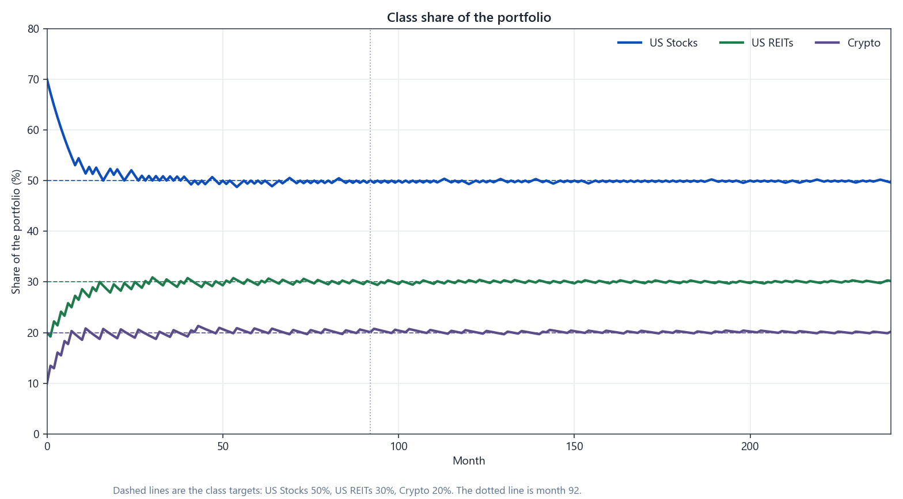
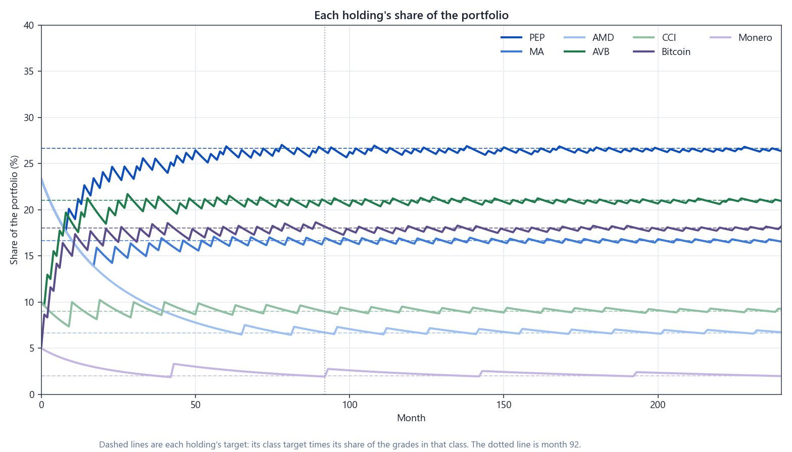
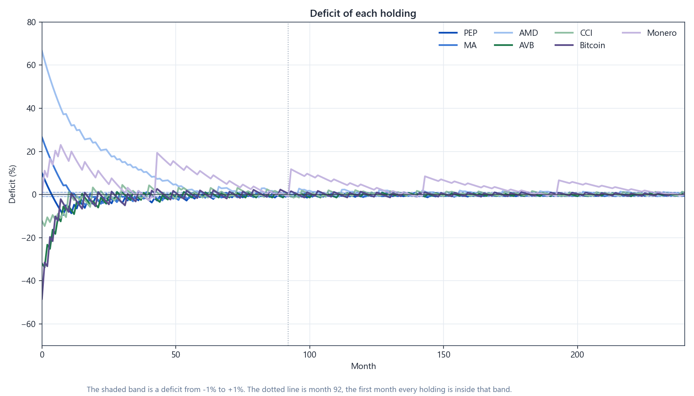

# Portfolio

One list of US stocks, US REITs, US ETFs, Brazilian stocks, Brazilian FIIs, Brazilian ETFs, and crypto.

Open `index.html` in the browser. Nothing else has to be running.

## How the app works

Search adds a holding. Each row stores an amount, up to 8 decimal places, and a grade from 0 to 10. The grade is how large that holding should be inside its class. A grade of 8 next to grades of 5 and 2 should hold 8/15 of the class.

Settings holds three choices:

- Currency is BRL or USD. Prices are converted into that currency.
- Allocation is the target share of each class. The seven class targets together cannot pass 100%.
- Backup exports or imports the currency, the class targets, and each holding's amount and grade.

The page asks for prices when you search, then about every 15 seconds while the list is on screen. It pauses when the tab is hidden. The list stays in the browser.

Each holding shows one deficit next to the trash icon. The list stays sorted from the lowest deficit to the highest, so the next contribution is the top row. A negative number is behind its target. Zero is on target. A positive number is ahead, and it keeps a `+` sign. The floor is -100%. There is no cap on a positive number.

The deficit uses the same two ratios for every holding that has a grade above 0:

- C is the class's current share of the portfolio, divided by the class target.
- A is the holding's current share of that class, divided by its grade share of the grades above 0 in the class.
- The score is `C^0.7 × A^0.3`. The badge shows `(score − 1) × 100`.

The class target supplies 70% of the score and the grade supplies 30%. A class target of 0, an empty grade, or a grade of 0 leaves the badge empty. One graded holding in a class is always 100% of that class, so changing its grade from 1 to 10 does not move the badge. A second graded holding in the same class does.

## Why the order of new money matters

You do not have to sell an overweight holding to repair the mix. New money can go to whatever is furthest behind. The badge answers that question with both the class target and the grade, instead of with the class target alone or the grade alone.

If you always add to the lowest deficit, the portfolio walks toward the targets you set. Holdings that are already ahead wait. Holdings that are behind receive the next deposit.

## A 20-year plan with prices held flat

This example starts with $25,000 and adds $1,000 at the end of each month for 240 months. Prices do not change, so a holding grows only when it receives a deposit. Nothing is sold.

The class targets are the ones in Settings:

| Class | Target | Starting value | Starting share |
| --- | ---: | ---: | ---: |
| US Stocks | 50% | $17,500 | 70% |
| US REITs | 30% | $5,000 | 20% |
| Crypto | 20% | $2,500 | 10% |

The wallet is three US stocks, two US REITs, Bitcoin, and Monero. PEP, MA, AMD, AVB, and CCI were drawn at random from large US listings. Each class starts split into equal dollars, so the grades are what make the holdings unequal.

| Holding | Class | Grade | Starts at | Target share of the portfolio |
| --- | --- | ---: | ---: | ---: |
| PepsiCo (PEP) | US Stocks | 8 | $5,833.33 | 26.67% |
| Mastercard (MA) | US Stocks | 5 | $5,833.33 | 16.67% |
| AMD | US Stocks | 2 | $5,833.33 | 6.67% |
| AvalonBay (AVB) | US REITs | 7 | $2,500 | 21% |
| Crown Castle (CCI) | US REITs | 3 | $2,500 | 9% |
| Bitcoin | Crypto | 9 | $1,250 | 18% |
| Monero | Crypto | 1 | $1,250 | 2% |

The three stock amounts are one third of $17,500 each. A grade of 8, 5, and 2 splits the 50% stock target into 26.67%, 16.67%, and 6.67%. AvalonBay's grade of 7 is 70% of the REIT grades, so its portfolio target is 21%. Monero's grade of 1 is 10% of the crypto grades, so its portfolio target is 2%.

Each month the whole $1,000 goes to the holding with the lowest deficit. That is the same choice the app makes when it puts that holding at the top of the list. Ties keep the order PEP, MA, AMD, AVB, CCI, Bitcoin, Monero.

At the start, Bitcoin is the furthest behind, at -48.4%. AMD is the furthest ahead, at +66.6%, because it holds a third of the stocks while its grade only calls for 2/15 of that class. The first deposits go to Bitcoin and AvalonBay.

### Classes

The class mix leaves 70/20/10 quickly. By month 12 the portfolio is 52.7% stocks, 27.0% REITs, and 20.3% crypto. By month 60 it is 50.0%, 29.4%, and 20.6%. After that, the $1,000 deposits only nudge the classes around the 50/30/20 lines.

At month 240 the portfolio is worth $265,000:

| Class | Target | End value | End share | Deposits received |
| --- | ---: | ---: | ---: | ---: |
| US Stocks | 50% | $131,500 | 49.62% | $114,000 |
| US REITs | 30% | $80,000 | 30.19% | $75,000 |
| Crypto | 20% | $53,500 | 20.19% | $51,000 |

### Holdings

The class chart can look finished while a holding inside the class is still far from its grade. At month 12, stocks are already near 50%, but AMD is still at +32.2% because it is too large for a grade of 2. Mastercard is near its own target. PepsiCo, the grade 8 stock, is the one still catching up inside the class.

The dashed lines are those grade targets. Over the 240 months the solid lines settle on them:

| Holding | Deposits | End value | End share | Target share | End deficit |
| --- | ---: | ---: | ---: | ---: | ---: |
| PEP | $64,000 | $69,833.33 | 26.35% | 26.67% | -0.7% |
| MA | $38,000 | $43,833.33 | 16.54% | 16.67% | -0.5% |
| AMD | $12,000 | $17,833.33 | 6.73% | 6.67% | 0.0% |
| AVB | $53,000 | $55,500 | 20.94% | 21% | +0.2% |
| CCI | $22,000 | $24,500 | 9.25% | 9% | +1.1% |
| Bitcoin | $47,000 | $48,250 | 18.21% | 18% | +0.7% |
| Monero | $4,000 | $5,250 | 1.98% | 2% | +0.1% |

AMD receives only 12 deposits because it began far above its grade. Monero receives 4. Bitcoin receives 47, because the crypto class started at half its target and Bitcoin's grade is 90% of that class.

### Months until every deficit is within 1%

**Month 92** is the first month in which every holding's deficit is inside ±1.0%, using the same one-decimal percentage the app shows.

| Holding | Deficit at month 92 |
| --- | ---: |
| PEP | -0.4% |
| MA | +0.5% |
| AMD | +0.1% |
| AVB | -0.2% |
| CCI | -0.2% |
| Bitcoin | +0.4% |
| Monero | -1.0% |

The classes that month are 50.00% stocks, 29.91% REITs, and 20.09% crypto.

The portfolio does not stay inside that band after month 92. A full $1,000 deposit is large next to Monero, whose target is only 2% of the portfolio, so one deposit can push a small holding back outside ±1%. All seven holdings are inside the band in 19 of the 240 months. The last of those months is month 238. At month 240, Crown Castle is the only holding outside it, at +1.1%.

## Prices were held flat

This simulation keeps every price flat for all 240 months. A real portfolio will not do that. Prices, dividends, and exchange rates move the class shares and the grade shares between deposits, so the same $1,000 plan will not produce this path under live market conditions.
